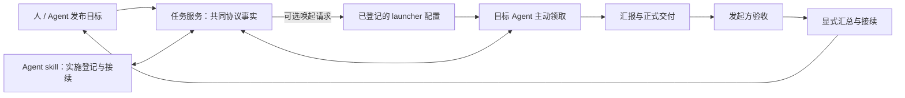

# Task Ledger Demo

**让人与 Agent 的工作有记录、有交付，也能接着做下去。**

A personal task ledger for people and agents — and a proving ground for an open task protocol.

Task Ledger Demo 希望把个人与 Agent 的日常协作连接起来：人登记目标和验收结果，Agent 记录实施、领取工作、委派协作者、汇报交付，再把成果整理成下一次可以接续的上下文。

它也是 [Agent↔Task Bridge](https://github.com/Csneer/agent-task-bridge) 的独立实践项目。通过产品设计、真实使用、故障注入和压力测试，检验任务协议能否支撑实际工程，并把发现的缺口与改进建议反馈给协议项目。

**当前已实现 S2 的 Go 任务核心、SQLite 持久事务和受信宿主调用入口，尚无可部署服务或前端。** 后端使用 Go；前端暂定。基础采用固定版本的 `task-core-draft-1`，不是现有 M1 daemon 的界面或客户端。

## 想实现的体验

- **随时登记工作。** 人发布任务并填写预期；Agent 通过配置 skill 登记正在实施的工作，留下目标、进展、决定、验证和下一步。
- **让合适的 Agent 接手。** 登记稳定身份与能力资料，开放领取或指定 Agent；需要时通过登记的唤起配置启动目标 Agent，由它主动领取。
- **多个参与者各自负责。** 把复杂目标拆成关联任务，多个 Agent 或人分别实施；每份工作有明确的承接、交付和验收事实。
- **收到结果再决定完成。** 预期可以在协作中明确和修订；执行者提交结果后，由发起者判断是否接受。实施会话结束、进程启动和任务完成分别记录。
- **回来后知道从哪里继续。** 通过项目摘要、时间线、交付引用和显式交接记录接续工作，减少对某个私有会话的依赖。

同一个任务同时只有一个当前承接者；多个 Agent 的并行工作使用多个关联任务。唤起成功不等于领取，子任务完成不自动完成父任务，交付也不自动通过验收。

## 为什么做一个实际工具

协议不仅要能描述消息，还要经得住日常工作中的问题：指定 Agent 时会不会被其他 Agent 抢走？实施登记中途断线后会不会创建重复任务？同一身份被启动两次时，谁有权继续执行？Agent 发起的任务能否由人接手验收？积累大量历史后还能否及时恢复上下文？

这些问题会在设计阶段暴露，也要在运行中验证。本项目分别记录协议表达不足、实现缺陷、宿主规则和容量瓶颈，避免用单一“压测通过”掩盖不同问题。已有的设计发现见[协议实践发现](docs/protocol-findings.md)。

## 与 p-drive 和协议项目的关系

借鉴 p-drive 的项目上下文、实施登记和接续体验；本项目使用独立的 Go 实现和协议事实，不复制其运行栈或会话状态机。p-drive 不是运行依赖。

协议项目定义 Task、Assignment、Run、Submission、Decision 等共同语义。本项目补上个人工具需要的身份目录、项目分组、定向资格、skill、实施会话和可选唤起，并用实际工程检验两者的分工。注册、命令唤起、通信和汇总都不被强行塞进核心协议。

## 当前进展

| 已建立 | 尚待实现与验证 |
|---|---|
| Go 核心的 11 个操作、精确 JSON 与固定协议校验 | 真实 HTTP binding、凭据适配与签名 cursor |
| SQLite/WAL 原子保存任务、应用记录、回执与事件 | 公开查询、完整事件接续与实际客户端互操作 |
| 受信 Go 入口中的身份目录、项目、定向资格与执行会话 | 可安装 skill、handoff、受控 launcher 与前端 |
| 并发领取、幂等重试、事务回滚与进程退出恢复测试 | 真实日常使用、完整故障矩阵与压力容量结果 |
| 设计阶段的协议发现记录 | 上游提案处理、升级与回归证据 |

验证区分契约结构与实际 Go 行为：前者检查协议来源和消息形状，后者使用文件数据库、并发调用及子进程故障验证状态与事务。证据与限制见 [S2 实施结果](docs/validation/s2-results.md)。这些测试尚未经过 HTTP 或真实 Agent 客户端，不代表完整 binding 符合性或可部署版本。

## 继续了解

| 关注点 | 文档 |
|---|---|
| 产品目标与完整日常链路 | [产品范围](docs/product.md) |
| 模块、事务与状态边界 | [架构设计](docs/architecture.md) |
| skill、注册、实施登记和唤起 | [Agent 接入设计](docs/agent-integration.md) |
| 协议依据与应用接口 | [协议采用说明](protocol/README.md) · [S1 binding 基线](docs/binding.md) |
| 设计发现、可靠性与压测 | [协议实践发现](docs/protocol-findings.md) · [验证计划](docs/validation.md) |
| 分阶段任务与参与方式 | [路线图](docs/roadmap.md) · [贡献说明](CONTRIBUTING.md) |

欢迎用具体协作场景和可复现反例参与，让这个工具既能记录实际工作，也能为开放任务协议积累可信的工程证据。
