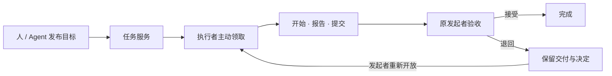

# Task Ledger Demo · Task Orbit

**把人和 Agent 的目标、执行、交付与验收，留在同一份可追溯的任务记录里。**

A personal task ledger for people and agents, with a visual workspace and an open task protocol.

[](https://github.com/Csneer/task-ledger-demo/actions/workflows/ci.yml)
[](https://github.com/Csneer/task-ledger-demo/releases/tag/v0.1.0)
[](LICENSE)

Task Ledger 是一个独立的 Go 服务，提供 SQLite 持久化、公开 HTTP 接口和 Python Agent Skill；**Task Orbit** 是随服务一起提供的网页工作区。你可以在页面发布目标，在自己的 Codex、Claude Code 或 Pi 会话中安排 Agent 执行，再回到页面查看报告、核对成果并接受或退回交付。

当前版本为 **v0.1.0 Developer Preview**，适合本机或受控私网中的单实例试用。自动化与真实 Agent 联调已有验证，真人长期使用和完整容量评估仍在继续。

[下载预览版](https://github.com/Csneer/task-ledger-demo/releases/tag/v0.1.0) · [发行说明](docs/releases/v0.1.0.md) · [安装与运维](docs/operations.md) · [Agent Skill](skills/task-ledger/SKILL.md)

需要搭建宣传站时，可使用[公开演示部署适配](deploy/public-demo/README.md)：访客免登录浏览独立演示数据，也可以提交公开文字任务；维护者决定是否承接和验收。适配层限制公开操作，私有服务和 Agent 仍通过受控入口访问。这部分代码随仓库提供，不在已发布的 v0.1.0 附件中。

## 可以用它做什么

- **把目标交代清楚。** 按项目发布任务，填写目标和预期结果；可以开放领取，也可以限定某个 Agent 的领取资格。
- **看清谁在做、做到哪里。** 记录当前承接者、执行轮次、进展报告、正式交付和验收决定；会话退出不会把任务悄悄标成完成。
- **组织多人的协作。** 使用子任务、关联任务和并行尝试分工，每项工作保留自己的执行与验收历史。
- **回看一项工作的来龙去脉。** Task Orbit 提供任务链总览、搜索定位、单任务时间线和真实事件顺序回放，支持窄屏与减少动态效果。
- **在断线后核对事实。** Skill 在写入前保存请求意图，使用稳定 ID 查询或重试未知结果；成功回执和事件 cursor 随数据库持久保存。



**提交不等于完成，只有任务的原发起者可以验收。** 同一任务同时只有一个当前承接者；并行工作使用多个关联任务。子任务完成不自动完成父任务，指定 Agent 也不等于启动或领取任务。

## 快速开始

### 1. 下载并校验

发行包包含 daemon、内嵌网页、Skill、初始化工具、运维模板和文档。运行预编译包无需 Go、Node.js、npm 或额外前端服务器；下面的首次配置与 Skill 需要 **Python 3**。

| 平台 | 下载 | 验证范围 |
|---|---|---|
| Linux x86_64 / amd64 | [linux_amd64.tar.gz](https://github.com/Csneer/task-ledger-demo/releases/download/v0.1.0/task-ledger-demo_v0.1.0_linux_amd64.tar.gz) | 实际安装、HTTP/Skill 与恢复 smoke 已覆盖 |
| Linux aarch64 / arm64 | [linux_arm64.tar.gz](https://github.com/Csneer/task-ledger-demo/releases/download/v0.1.0/task-ledger-demo_v0.1.0_linux_arm64.tar.gz) | 仅交叉编译，尚无 arm64 实机验收 |
| 校验清单 | [SHA256SUMS](https://github.com/Csneer/task-ledger-demo/releases/download/v0.1.0/SHA256SUMS) | 发布附件的 SHA-256 摘要 |

在 Linux 的 Bash 中执行以下命令。需要 `curl`、`tar` 和 GNU `sha256sum`；下载目录只存安装包，不存运行数据。

```sh
set -eu
case "$(uname -m)" in
  x86_64) ledger_arch=amd64 ;;
  aarch64|arm64) ledger_arch=arm64 ;;
  *) echo '此预览包仅提供 Linux amd64 / arm64' >&2; exit 1 ;;
esac
ledger_version=v0.1.0
ledger_name="task-ledger-demo_${ledger_version}_linux_${ledger_arch}"
ledger_url="https://github.com/Csneer/task-ledger-demo/releases/download/${ledger_version}"
mkdir -p "$HOME/Downloads/task-ledger-${ledger_version}"
cd "$HOME/Downloads/task-ledger-${ledger_version}"
curl -fLO "$ledger_url/$ledger_name.tar.gz"
curl -fLO "$ledger_url/SHA256SUMS"
awk -v archive="./$ledger_name.tar.gz" '$2 == archive' SHA256SUMS | sha256sum --check --strict
test ! -e "$ledger_name"
tar -xzf "$ledger_name.tar.gz"
cd "$ledger_name"
bin/taskledgerd -version
```

校验时只检查已下载的附件，其他架构的包无需下载。若同名解包目录已存在，命令会停止；已有安装请按[升级说明](docs/operations.md#升级与回退)处理。

### 2. 初始化一个新的私有实例

仍在解压后的包根目录执行：

```sh
mkdir -p "$HOME/.local/state"
python3 tools/init-config.py \
  --dir "$HOME/.local/state/task-ledger" \
  --authority personal --port 8090
bin/taskledgerd -config "$HOME/.local/state/task-ledger/server.json" -init
bin/taskledgerd -config "$HOME/.local/state/task-ledger/server.json"
```

初始化工具要求父目录已存在、目标目录尚不存在；它不会覆盖已有配置。运行目录权限为 `0700`，配置和凭据为 `0600`。`-init` 仅在首次创建数据库时执行一次，日后启动只执行最后一条命令。前台服务可用 `Ctrl+C` 优雅停止。

浏览器打开 **[http://127.0.0.1:8090/](http://127.0.0.1:8090/)**，在连接入口输入私有文件 `~/.local/state/task-ledger/owner-token` 中的凭据。请在本机读取它，不把凭据粘贴到聊天、任务正文或版本库。页面仅将凭据保存在当前标签页的 `sessionStorage`。

这套默认配置仅监听本机。需要长期运行时，按[运维说明](docs/operations.md)安装版本化二进制和 systemd 用户服务；需要局域网访问时，按[后台接入](docs/backend.md)配置 TLS 与可信 CA。非 loopback 监听必须启用 TLS。

### 3. 完成第一条协作闭环

1. **以 owner 连接页面，创建项目。** 从顶部工作区入口建立项目，再发布一个目标和预期结果都明确的小任务。
2. **配置 Agent 身份。** 管理者登记独立的 Agent 参与者，为它配置自己的凭据并重启服务加载。参与者登记不会自动签发凭据；具体步骤见[身份登记与凭据更新](docs/backend.md#身份登记与凭据更新)。不要让 Agent 共用人的 owner 凭据。
3. **在你已有的助手会话中安排执行。** 将包内 `skills/task-ledger/` 整体安装到客户端的 skills 目录，或让助手读取其中的 `SKILL.md`。给它任务的完整 TaskRef、工作区和私有客户端配置的路径，凭据文本不进入提示词。
4. **由 Agent 主动领取并交付。** Skill 完成实施会话登记，以及 `claim → start → report → submit`，保留请求意图和会话证明。协作需要多个执行者时，派生协作者并分别使用关联任务。
5. **回到页面验收。** 读取报告与正式交付，核对实际成果后接受或退回。退回后的任务可由原发起者重新开放，先前的交付和决定继续保留。

网页不会自动启动 Codex、Claude Code 或 Pi。使用你当前助手会话提供的派生或调用能力来运行 Agent；这些客户端也不是服务运行的必要依赖。完整操作与异常恢复见 [Skill](skills/task-ledger/SKILL.md)、[HTTP 示例](skills/task-ledger/references/http.md)和[真人验收清单](docs/human-acceptance.md)。

## 架构与协议

```text
Task Orbit 浏览器 ─┐
                  ├─ 同源 HTTP API ─ taskledgerd ─ SQLite / WAL
Agent Python Skill┘                   │
                            固定版本的任务协议与 binding
```

- **服务端**：Go 核心、SQLite 事务、Bearer 凭据映射、任务快照和签名事件 cursor。
- **前端**：原生 ES modules / CSS / HTML，编译时嵌入 daemon，不依赖在线 CDN。
- **客户端**：Python 标准库 Skill，通过公开 HTTP 接口协作，不读写服务数据库。
- **协议**：任务核心为 `task-core-draft-1`，应用 HTTP binding 为 `ledger-http-draft-1`；输入按上游提交与校验和固定。

[Agent↔Task Bridge](https://github.com/Csneer/agent-task-bridge) 提供本项目采用的任务语义；Task Ledger 是独立的应用与实践验证项目。Bridge 已发布的 M1 daemon 使用 `bridge-m1-1`，**本项目不是该 daemon 的界面或兼容客户端**。p-drive 的上下文与接续体验是设计参考，不是运行依赖。协议缺口与实现问题分别记录在[协议实践发现](docs/protocol-findings.md)。

## 预览版范围与验证

当前工程验证包括固定协议校验、114 个结构向量、Go race/vet/build、7 项 Skill 测试、2 项初始化边界测试、46 项前端单元测试，以及 17 组浏览器流转和 13 组可用性检查。真实客户端联调覆盖本地 Codex / Pi / Claude 与远端 Codex；发行包安装、最新停机状态恢复和短时混合负载也有记录。

- [发布准备证据](docs/validation/release-prep-20261101.md)：发行包、浏览器、恢复、持久部署与有界负载的具体条件和结果。
- [真实 Agent 验收](docs/validation/s3-agent-acceptance.md)：客户端互操作范围与未覆盖项。
- [持续集成](https://github.com/Csneer/task-ledger-demo/actions/workflows/ci.yml)：查看具体提交的检查；tag 发布在同一次运行的检查通过后使用已验证附件。

**这些证据不代表稳定生产版或真人日常验收已经完成。** 当前仅支持单 authority、单服务进程的本机或受控私网使用；不提供自动 launcher、handoff、跨 authority 互操作、公网多租户、任意旧数据库回滚或容量保证。短时负载结果不是饱和容量或长期稳定性结论。现有接口还有 workspace 对象与响应大小限制，详见[后台边界](docs/backend.md#http-与查询边界)。

## 从源码开发

需要 `go.mod` 指定的 **Go 1.27+**、Python 3 和 Node.js 22+；CI 使用 Node.js 22。日常运行二进制不需要 Node.js，npm 依赖只用于浏览器验证。

```sh
git clone https://github.com/Csneer/task-ledger-demo.git
cd task-ledger-demo
make check
mkdir -p dist/dev
go build -o dist/dev/taskledgerd ./cmd/taskledgerd
```

`make check` 执行协议/结构校验、Go race 测试与 vet/build、Python 客户端/初始化测试和前端单元测试。浏览器回归使用隔离实例：

```sh
npm ci
npx playwright install --with-deps chromium
export CHROME_PATH="$(node --input-type=module -e 'import {chromium} from "playwright"; console.log(chromium.executablePath())')"
make browser-check
```

干净、已提交的 checkout 可用 `make release` 构建两个 Linux 架构的包，再用 `make release-smoke` 验证 amd64 安装和恢复。构建输出目录必须为空；贡献约定见 [CONTRIBUTING.md](CONTRIBUTING.md)。

## 文档与反馈

| 需要了解 | 入口 |
|---|---|
| 配置、凭据与 Agent 接入 | [后台接入](docs/backend.md) · [Skill](skills/task-ledger/SKILL.md) |
| 持久部署、备份与升级 | [运维说明](docs/operations.md) |
| 任务画布、回放、重做与并行 | [前端说明](docs/frontend.md) · [设计约定](DESIGN.md) |
| 产品边界与后续方向 | [产品范围](docs/product.md) · [路线图](docs/roadmap.md) |
| 系统结构与协议采用 | [架构](docs/architecture.md) · [协议说明](protocol/README.md) · [HTTP binding](docs/binding.md) |
| 发行历史与验收 | [发行说明](docs/releases/v0.1.0.md) · [CHANGELOG](CHANGELOG.md) · [真人验收](docs/human-acceptance.md) |

欢迎通过 [Issues](https://github.com/Csneer/task-ledger-demo/issues) 提交具体协作场景、可复现问题和改进建议。安全问题请使用 [私密漏洞报告](https://github.com/Csneer/task-ledger-demo/security/advisories/new)，处理方式见 [SECURITY.md](SECURITY.md)。本项目采用 [MIT License](LICENSE)。
