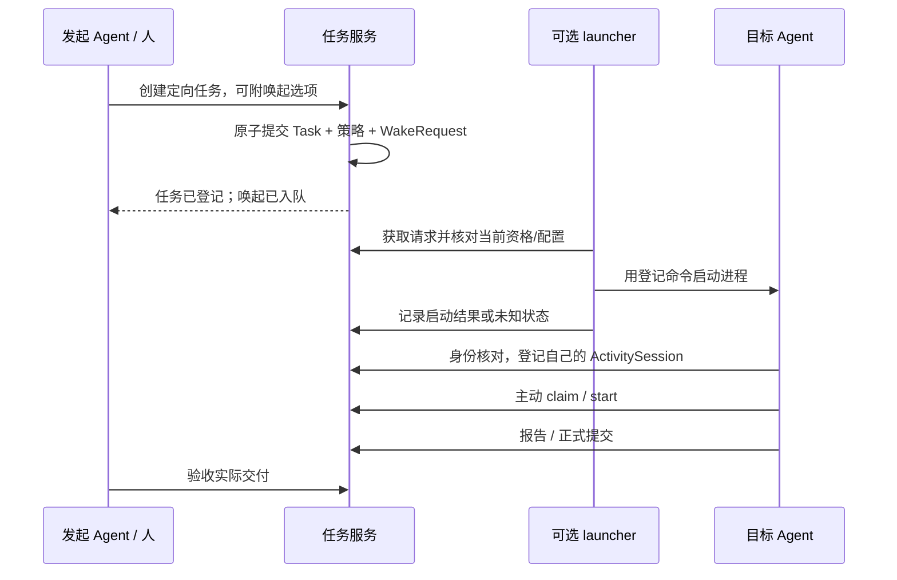

# Agent skill、实施登记与可选唤起

状态：S3 已实现 HTTP 后台与[可安装 Skill](../skills/task-ledger/README.md)，接口规范沿用 [binding 基线](binding.md)。运行配置见[后台接入](backend.md)，真实客户端证据见 [S3 验收记录](validation/s3-agent-acceptance.md)。本文同时保留 S4 可选唤起设计，不能把未实现部分当成当前能力。

首次接入请从[Agent 快速接入与主子任务闭环](agent-quickstart.md)开始：`agent.py` 提供一次配置后的简单任务命令、主/子 Agent 提示模板、验收与恢复。当前通过已有助手会话派生执行者；下文的 launcher / WakeRequest 流程是后续设计。历史四客户端验收与新的便捷 Skill 验收分别记录，不能互相替代。

## Skill 是日常接入入口

Agent 宿主加载 skill 后，通过薄客户端访问服务。skill 引导何时登记、如何查任务、如何汇报和交付；服务仍是权威事实来源。skill 不拥有修改数据库、跳过角色检查或把失败隐藏为成功的能力。

| 配置/登记项 | 含义与边界 |
|---|---|
| 服务地址、authority、预期版本 | 定位服务并核对协议/binding 支持；不兼容时明确停止相关调用 |
| 稳定 ActorRef、注册回执 | 首次由管理者登记/批准，返回真实引用；后续核对，不按名称自动合并或重建身份 |
| 凭据引用 | 使用环境或宿主秘密引用；不写进任务、skill 正文或共享资料 |
| display_name、provider、模型/能力资料 | 展示与选择参考；不是认证证明，也不自动授予执行或唤起权 |
| 默认 Project、工作空间引用 | 帮助归属与接续；本机目录/会话原文不默认上传 |
| 可选 LaunchProfile 引用 | 指向管理者登记的唤起配置；Agent 自报配置不能立即变成可执行命令 |

当前 skill 引导身份核对、实施会话登记、发现/领取任务、报告、交付与验收，以及通过现有宿主工具协作；未来的可选唤起和 handoff 不在当前实现内。HTTP 路径与契约级配置在 S1 固定；助手使用 [Skill 文件配置](../skills/task-ledger/SKILL.md)，将 `skills/task-ledger/` 整个目录复制到客户端支持的 skills 目录，或显式读取其中的 `SKILL.md` 即可接入。凭据由管理员带外提供，助手不自动注册身份或签发凭据。

## ActivitySession 与协议执行分开

ActivitySession 保存 session ID、真实 actor、可选 provider/host/workspace 引用、项目、公开目标、阶段、摘要、状态和时间。执行绑定另行关联 TaskRef/Assignment/Run；决定、验证、阻塞和下一步目前写入公开摘要，不是独立结构字段。它记录一次实施会话，不能替代 Task 的工作责任和完成事实。

当前应用动作是 `session.begin/update/rotate/end/transfer`，不是新增核心 operation；heartbeat 使用 `session.update`。heartbeat 只更新存在信息；最近未汇报应显示为未知或登记过期，不能据此令 Task failed、释放承接或创建新一轮执行。end 结束会话，不自动生成 Decision。正式交付仍须 `run.submit`，验收仍须真实 issuer `task.decide`。

会话关联与作者信息不可通过客户端随意填写获得资格。宿主在成功 claim 时共同记录 Assignment 对应的当前执行 ActivitySession，后续新执行命令核对该绑定。恢复同一个会话需要可验证的恢复凭据；换会话继续需要显式交接和原子替换执行资格。仅知道 session_id、TaskRef 或相同 Agent 身份不构成恢复证明。

## 两条实施登记路径

**已有任务：** 身份核对 → 登记会话 → 读取任务与最新预期 → 本会话合法 claim → start → 实际工作/报告 → submit → issuer 验收。

**自发工作：** 登记会话和实施意图 → 以真实 Agent 为 issuer 创建 Task（目标和预期必填）→ 自己 claim/start，或发布给其他 Agent → 后续按协议交付与决定。

自发创建的任务不能把用户冒充为 issuer。Agent 自发、自执行、自验收是可如实表达的事实，不应在界面称为“人已验收”。如果需要人的最终验收，由人真实发起工作任务，或另外创建由人发起的汇总任务。此限制已登记为[设计发现 F01](protocol-findings.md)。

登记会话允许暂时没有 Task/Run 关联，因为创建、领取或启动可能尚未完成；没有关联时只能记录接入进度，不能将会话当成已获得任务执行权。会话与任务建立联系后保存引用，不靠同名标题猜测。

## 组合操作与重试

begin/create/claim/start 是多个可分别提交的操作。客户端或服务侧接入账本保存稳定的实施意图 ID、session、目标 TaskRef、每一步独立 command_id、完整请求与已知结果；不是跨请求自动原子事务。

| 中断位置 | 恢复规则 |
|---|---|
| create 响应未知 | 原封不动重试原命令；不新建 Task ID 或 command_id |
| create 成功、claim 失败 | 保留已发布任务与会话的部分进度，不删除事实或假报开始 |
| claim 成功、start 未成功 | 保留 claimed；核对当前承接与会话，再恢复原步骤或由合法主体明确释放 |
| submit 响应未知 | 重取原回执；不把结果未知直接记成业务失败 |
| 会话重连拿到旧回执 | 回执用于确认过去的提交；开始外部工作前另核对当前 Task/Assignment/Run 与会话归属 |

command_id 的幂等范围跨同一 actor/authority 的所有任务与操作，因此每一步使用不同 ID；同一 session ID 不能充当所有核心命令的 ID。应用组合操作记录也需要版本和幂等规则。

当前 `agent.py` 在私有 profile 中实现这些记录：每任务独立会话与检查点、每写步骤的原请求与回执，以及串行写锁。`take` 组合 begin/claim/start；`submit` 与 `finish` 分别返回交付和会话结束事实。`resume` 只读核对，`retry --operation ID` 原字节重放。存在未决写入时拒绝生成新业务写入；每次新写与重放前核对服务、协议和实际 Actor，防止凭据轮换把历史意图带到另一个身份。

## 委派与唤起链路（唤起待 S4）

外部进程启动必须位于持久事务之外。Task、ClaimPolicy 和可选 WakeRequest 可在一笔创建事务中提交，launcher 只能读取已提交的请求；回滚数据库不能撤销已发生的外部启动。

WakeRequest 记录意图、TaskRef、目标 ActorRef、固定 LaunchProfile revision、请求者与幂等键；WakeAttempt 记录一次投递/启动的结果和可核对的 activation ID。拟议状态包括 queued、started、failed、unknown、skipped；状态描述启动事实，不承诺已领取或开始工作。状态表见[读取唤起契约](contracts/reads-dispatch.md)，包含 reserved/authorized 等中间状态。

任务创建重试不能重复创建 WakeRequest，target/profile/wake 选项纳入完整应用请求的等价判断。之后再次唤起属于新的显式应用意图，有自己的幂等键和限流。缺少可用配置时，带 wake 的创建整笔拒绝；调用者可明确发出不带 wake 的新意图，不得悄悄执行默认命令或降级为仅建任务。

## 唤起配置与失效核对

LaunchProfile 由管理者登记/批准，使用固定 executable 与 argv 模板、允许的工作目录、执行端和环境引用。只有少量已定义的数据字段能作为独立 argv 传递；任务正文和提示词通过服务读取，不拼入 shell。Agent 登记资料不能自行覆盖 profile 或注入可执行文件。

投递前重新检查目标身份、profile 是否仍启用、任务当前状态和领取策略。引用的旧 profile 版本已撤销时跳过并留痕，不悄悄套用新版本命令。目标已领取、任务取消、身份停用或资格变更时，标记失效的唤起请求，而不改 Task 生命周期。

启动后响应丢失时，先按 activation ID 核对 launcher 的持久日志与实际启动证据；不能确认则保留 unknown。每个 wake 只有一次 activation，不自动再次 spawn；确认未启动后以明确的新 wake 意图重试。如果未来采用至少一次唤起，必须接受可能的重复进程并有独立抑制机制，不能承诺外部启动或业务副作用 exactly-once。

同一个 Agent 可以被重复启动，核心单承接只约束 ActorRef，不能区分两个同身份进程。宿主的执行会话绑定防止新进程借用旧会话的 Run；这不保证旧进程的外部动作立即停止。取消/撤销/接管后对外部资源的停止或隔离，需要另有可观察机制和验证。

## 实施输入与验证边界

当前 Skill 通过公开 HTTP 执行原始请求，并在写前持久保存请求意图；session secret 保存在独立私有文件，未知结果不自动重试。launcher 和进程控制尚未实现。S1 已固定注册管理、会话 proof/轮换/交接、claim 绑定、wake 状态和单次 activation、缺配置原子拒绝与每 runner 一个未决启动；精确规则见[身份会话契约](contracts/identity-session.md)和[读取唤起契约](contracts/reads-dispatch.md)。相关故障与压力场景见[验证计划](validation.md)。
