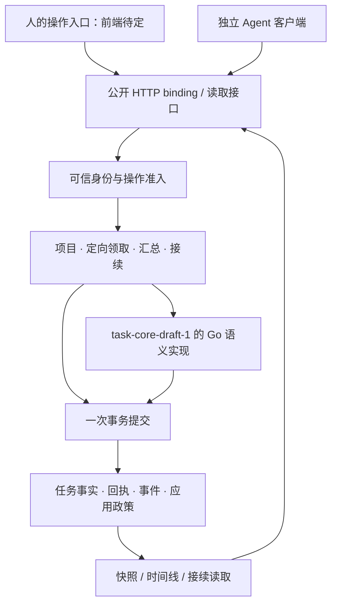

# 架构：个人任务账本与协议验证载体

状态：2026-10-31 的骨架设计，尚未实现运行服务。产品范围见[产品说明](product.md)，语义来源见[协议采用说明](../protocol/README.md)。

## 目标和边界

用一个日常可用的个人任务工具，检验共同协议能否支撑人和 Agent 的真实协作。协议的完整性需要从合法场景是否能表达、不同接入方是否理解一致来判断；可靠性还需要持久事务、恢复与压力下的不变量证据。

本项目将作为独立的 Go authority，而非现有 M1 daemon 的界面。一个工作空间对应一个 authority；Project 是其中的分组。首版面向个人或受控协作，前端暂定。应用、核心和适配先放在一个进程、一个 Go module 中，不提前拆成微服务。

## 运行结构的设计

图中均为待实现模块。存储首选候选为 SQLite/WAL；驱动、隔离和迁移方案在存储阶段定案。HTTP+JSON 是首个 binding 的计划方向，具体契约见[绑定草案](binding.md)，不是上游协议强制的通信方式。

## 模块职责

| 目录 | 职责 | 不能承担的职责 |
|---|---|---|
| `cmd/taskledgerd` | 配置与进程组装 | 当前尚无可执行入口 |
| `internal/core` | 11 个核心操作、状态守卫、版本、事实和协议错误 | 注册、匹配、HTTP、项目汇总 |
| `internal/registry` | 人/Agent 稳定目录、身份映射、启停 | 因为是管理员就修改任意 Task |
| `internal/application` | Project、ClaimPolicy、Summary/Handoff 用例 | 另一套 Task 状态机 |
| `internal/activity` | skill 实施登记、会话存在信息、Task/Run 关联与执行会话绑定 | 将会话 end 或失联直接当作任务完成/失败 |
| `internal/dispatch` | 注册的唤起配置、待处理唤起记录、结果核对 | 代目标 Agent claim、直接执行任务正文中的命令 |
| `internal/storage` | 事务、成功回执、事件、应用一致性、恢复 | 将部分提交包装成成功 |
| `internal/transport` | 消息映射、身份解析入口、查询、错误、cursor | 接受客户端自报 HostContext |
| `web` | 未来人类交互入口 | 直接写表或设置任务状态 |

目前 Go 包仅有职责注释；不提前定义大量占位接口、虚假成功返回或自动生成的业务层。

## 业务对象不替代协议事实

Task、Assignment、Run、Report、Submission、Decision 采用上游含义。核心 `Run` 是某次承接内的执行事实，不是 p-drive 的会话登记；不存在“会话 end 等于任务完成”的映射。

Project 组织多个 Task。Participant 记录稳定 ActorRef、展示名、启停和可选 Agent 资料。ClaimPolicy 限定谁可以领取。Timeline 是核心事件和应用管理事件的读取投影，必须区分两类来源。Handoff/Summary 是显式接续记录，引用确定版本的事实；需要实际执行和验收的汇总工作，建立独立 Task。

展示标题、模型名、主机和凭据不是身份键。ActorRef 在 authority 的宿主映射中稳定，目录项不硬删除，不将旧 ID 分配给新主体。核心比较包含 `kind` 和 `id`；同名的人和 Agent 不会相互冒用。

## 指定 Agent 与注册

首版由工作空间管理者登记或批准参与者，先不做公网自助注册。登记包含显示名、可选模型/能力声明、稳定 ActorRef 和启停状态；能力声明只是资料，不是性能保证或自动权限。人通过同样的参与者模型参与。

发布者可选择“符合工作空间准入的参与者可领取”或“仅某个登记 Agent 可领取”。这是 ClaimPolicy，不创建 Assignment，不替目标身份发送 claim，也不保证目标会接受。指定一个 Agent 的策略不能排斥它的合法历史结果读取。

Task 与初始 ClaimPolicy、项目关联必须一起提交后才对外可见。策略缺失不得短暂当作开放领取。变更策略仅允许在 `offered`，由任务 issuer 操作，携带应用 revision；与 claim 在事务中串行判断，不能先读旧策略再用新状态提交。活动中改派要先由合法参与者明确释放，再修改定向资格，新 Agent 主动领取。

管理者可停用身份、撤销后续准入，但停用不自动令 Task 失败或释放承接。新命令资格和历史成功回执的读取资格独立。停用承接者后由有效 issuer 明确释放；issuer 自己停用时保留待处理，可恢复同一身份，不能由管理者伪装成 issuer 代验收。代理权不属于当前草案能力。

## 多 Agent 分工、汇总与接续

一个 Task 同时最多一个当前承接者。人发起总任务 P，Agent A 承接 P；A 可以分别创建 C1、C2 让 B、C 领取，父子关联只表达分工。A 是 C1/C2 的 issuer，所以由 A 验收；人是 P 的 issuer，验收 A 汇总后的正式交付。

人如需直接验收每份子交付，应由人自己发起对应任务。人工 review 也可形成独立任务；其产物被真正 issuer 读取，不隐式改变原任务的决定权。

汇总应引用 TaskRef、源 revision、Submission/Decision 等具体事实及生成依据。项目 handoff 使用独立的应用 revision，按预期版本提交，不能从“最近一次报告”静默覆盖长期上下文。接续者先读摘要与来源，再按需读完整历史；没有显式前序关系就不推断接续。

同任务换执行者走 release → claim → start，新 generation 和 Run，不复活旧 Run。分支探索或可并行工作建立新任务。重放旧成功回执返回历史快照，读取方必须避免据此把当前任务视图倒退。

## 可靠性是服务的实施责任

一次成功写入应共同提交 Task 更新、改变的事实、事件、成功回执，以及该操作关联的应用元数据。内存模型中的原子性不能替代真实数据库事务。响应丢失后，同一完整请求重试返回原结果；竞争领取允许合法冲突，但只能产生一个当前承接。

应用外层参数必须纳入其回执等价判断：同一个核心 command_id 下改变 project 或指定 Agent，不能复用核心成功结果后再修改应用数据。身份暂停和定向策略的当前限制不能随意拦截有历史读取权的旧回执。具体封套和错误在 binding 阶段固定。

事件消费需按 authority/event_id 去重、按 Task revision 识别缺口，读取快照与后续事件必须有明确接续边界。核心没有定义网络 cursor、全局顺序或保留清理，这些由本项目另订；成功回执不能清理后把旧键当新请求执行。容量不足应明确失败，不能悄悄丢历史。

不把失联推断为执行失败，不承诺消息恰好一次，不执行任务正文中的任意代码。允许可选的受控 launcher 使用管理者登记的命令唤起 Agent；它与任务执行器分开，详见[Agent 接入设计](agent-integration.md)。首版没有自动租约计时，不能沿用 M1 租约测试声称新核心已有超时回收。

## Skill 接入与实施登记

Agent 通过配置服务地址、稳定身份和凭据引用的 skill 接入。收到已有任务时登记 ActivitySession 并关联合法承接；自发实施时先以真实 Agent 身份创建 Task，再 claim/start。登记会话记录 provider、工作空间引用、公开进展和接续信息，不保存完整私有会话。

ActivitySession 与核心 Run 独立：一个执行 Run 可以先后由多个明确交接的会话继续，但同一时刻只有一个获宿主执行资格的会话。会话 heartbeat 只说明存在信息，过期不能自动释放 Assignment；会话结束也不构成任务验收。组合登记的部分成功、请求重试和恢复要记录到应用操作账本，不能通过重建 Task 掩盖中断。

委派时先提交定向 Task 和 WakeRequest，再由可选 launcher 读取已登记的 LaunchProfile 唤起目标 Agent。启动失败保留任务待领；进程启动不等于协议 claim，更不等于交付或验收。重复唤起可能产生同身份的多个进程，宿主还须绑定执行会话，不能只依据 assignee 等于 ActorRef 放行。

## 实践反馈

每个验收结果标注协议 commit、demo commit、binding 版本、环境和证据。区分：规格无法决定结果的协议问题、违反明确规则的 Go 实现问题、宿主/产品规则问题，以及具体环境下的容量问题。

对照上游 Python 模型有助于检查语义，但不能代替独立预期和真实服务验证。独立客户端通过同一 Go 服务，只证明这个 binding 下的互操作；跨 authority 服务互操作要另有实现和证据。测试矩阵与压测计划见[验证计划](validation.md)。设计过程中已经暴露的限制和待提案项记录在[协议实践发现](protocol-findings.md)，不必等服务完成后才反馈。
